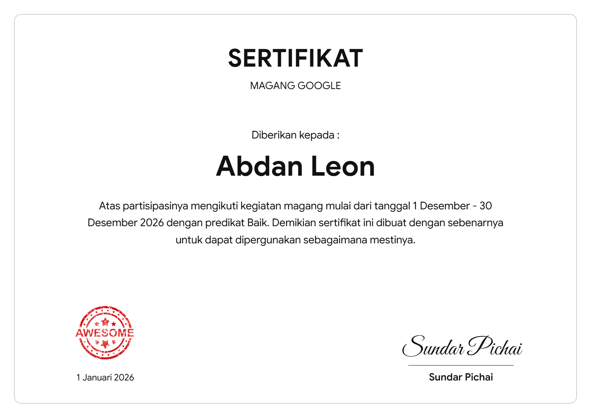

# Sertifikat Instan
Buat sertifikat minimalis secara cepat dan aman. Cocok untuk sertifikat seminar, webinar, volunteer, magang, dan lain-lain.
# Cara Pakai
<ul>
  <li>Tulis isi sertifikat di kolom edit.</li>
  <li>Cek hasilnya di live preview (tampilan di bawah kolom edit).</li>
  <li>Klik tombol Unduh Sertifikat lalu tunggu proses hingga selesai.</li>
  <li>File sertifikat akan tersimpan dalam bentuk PNG.</li>
</ul>

# Contoh Sertifikat

